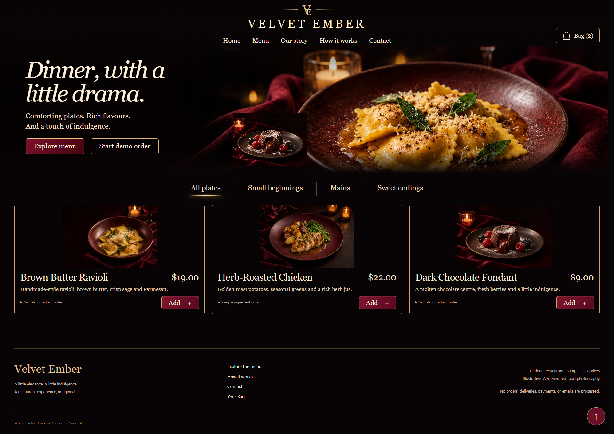
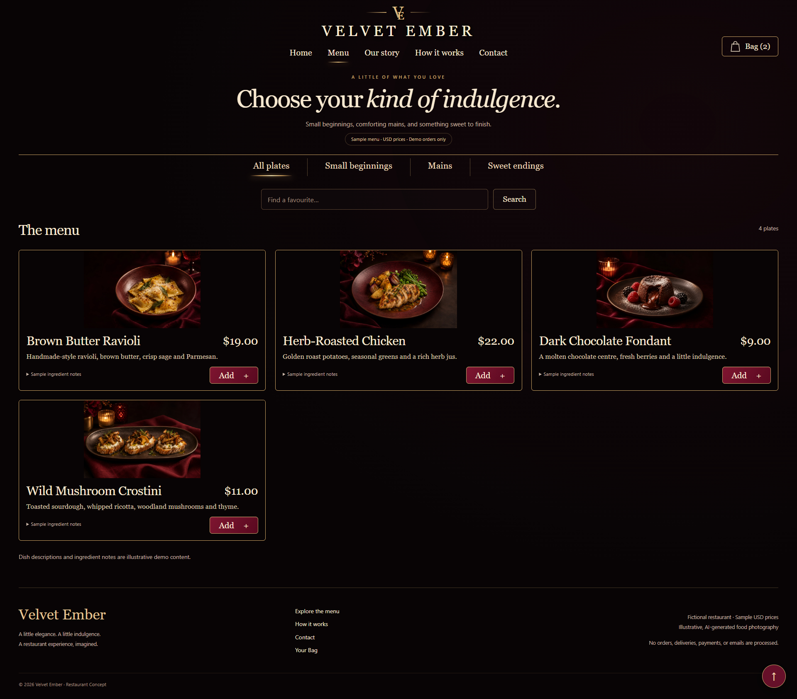
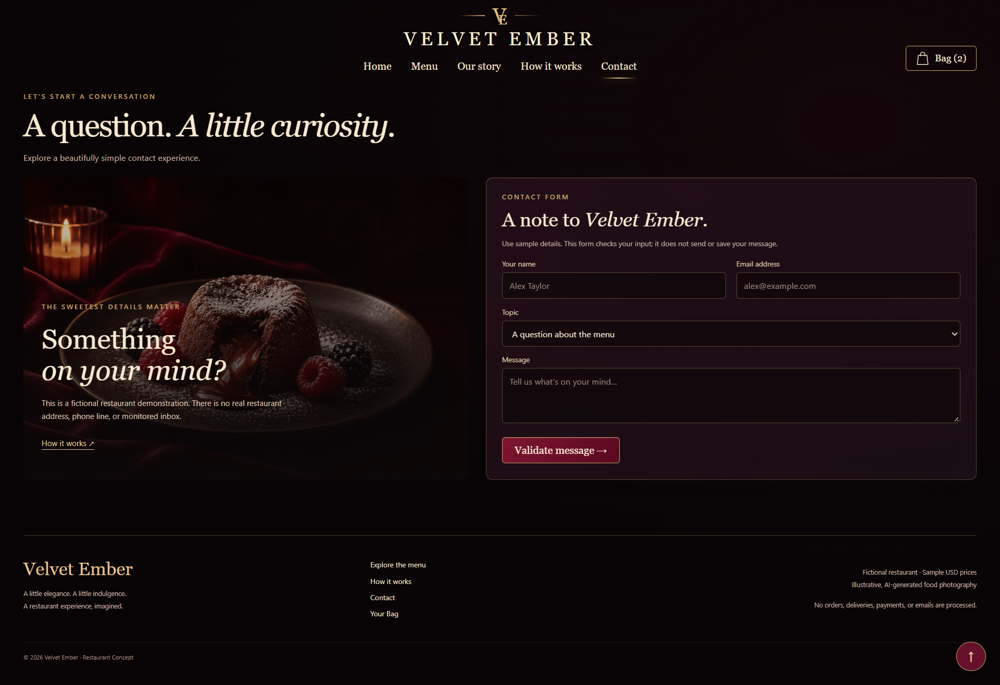

<div align="center">
<h1>Velvet Ember</h1>
<p><strong>Python · Django · HTML · CSS</strong></p>
</div>

Restaurant website demo with menu search, category filters, a session-based bag, and a validated contact form.

## 🖥️ Website preview

<a href="screenshots/Home.jpg"></a>

Click any image to open the original full-resolution capture.

### 📸 All page previews

<details>
<summary><strong>Menu</strong></summary>
<br />
<a href="screenshots/Menu.jpg"></a>
</details>

<details>
<summary><strong>Bag (Cart)</strong></summary>
<br />
<a href="screenshots/Bag%20%28Cart%29.jpg"></a>
</details>

<details>
<summary><strong>Our Story</strong></summary>
<br />
<a href="screenshots/Our%20Story.jpg"></a>
</details>

<details>
<summary><strong>How it Work</strong></summary>
<br />
<a href="screenshots/How%20it%20Work.jpg"></a>
</details>

<details>
<summary><strong>Contact</strong></summary>
<br />
<a href="screenshots/Contact.jpg"></a>
</details>

## Run locally (Windows PowerShell)

Use Python 3.14, matching the submitted project environment. Dependencies below were identified from the supplied environment metadata.

```powershell
python -m venv .venv
.\.venv\Scripts\python.exe -m pip install -r requirements.txt
$env:DJANGO_SECRET_KEY = (.\.venv\Scripts\python.exe -c "import secrets; print(secrets.token_urlsafe(50))")
.\.venv\Scripts\python.exe manage.py migrate
.\.venv\Scripts\python.exe manage.py runserver
```

Open http://127.0.0.1:8000/.

## Configuration

See `.env.example` for variable names. Set variables in your shell; this project does not automatically load `.env` files. If `DJANGO_SECRET_KEY` is omitted, a temporary random key is generated at startup; set a stable key to retain sessions across restarts.

## Scope

No real orders, payments, or emails are processed.

This is a learning/portfolio project. Local development settings are enabled by default. Production hosting requires a separate deployment configuration.

## Project layout

- `manage.py`: Django commands.
- `myproject/`: settings and root routes.
- `home/`: application views and routes.
- `templates/` and `static/`: interface templates and assets.

## Validation

Python syntax and Django system checks were run during portfolio preparation. External API responses and browser interactions were not tested end to end.
